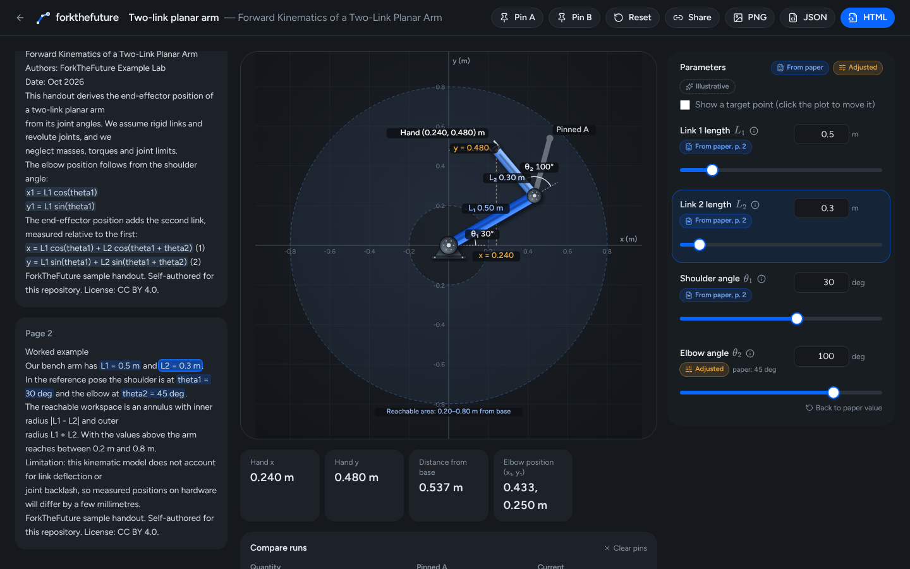
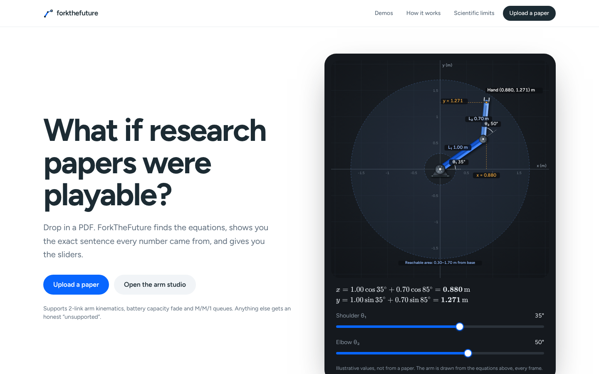
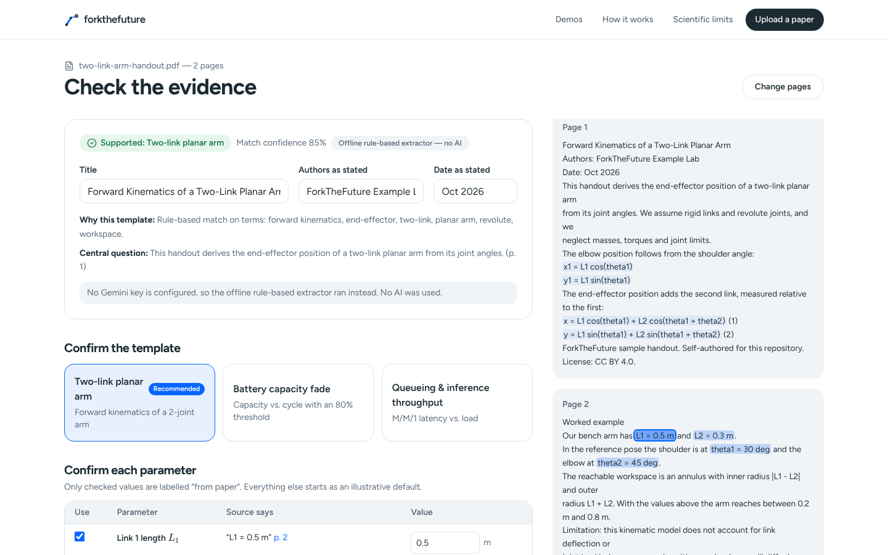
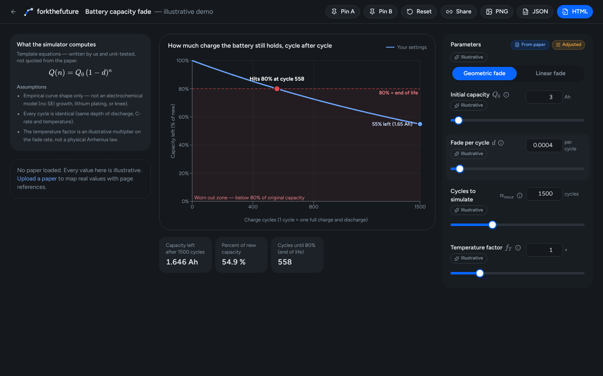
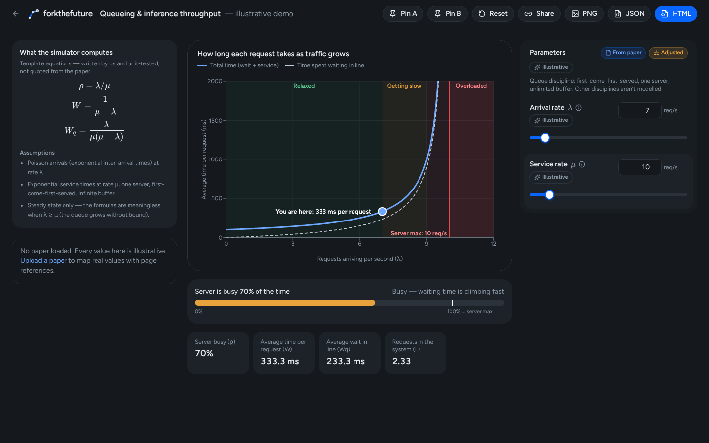

# ForkTheFuture

**Turn scientific papers into playable, inspectable experiments.**

Drop in a research PDF. ForkTheFuture extracts the text in your browser, finds equations and parameter values,
shows you the exact sentence and page each number came from, and — once you confirm them — runs a small,
unit-tested simulator you can play with.



**Videos:** [31-second walkthrough of the real app](docs/app-walkthrough.mp4) · [23-second launch video](brag-output/brag.mp4)

It supports three model families and is honest about everything else:

| Template | Equations | Validity |
| --- | --- | --- |
| Two-link planar arm | x = L₁cos θ₁ + L₂cos(θ₁+θ₂), y = L₁sin θ₁ + L₂sin(θ₁+θ₂) | Exact kinematics; no dynamics |
| Battery capacity fade | Q(n) = Q₀(1−d)ⁿ (or linear Q₀ − kn) | Empirical curve shape only |
| M/M/1 queue | ρ = λ/μ, W = 1/(μ−λ), Wq = λ/(μ(μ−λ)) | Only for λ < μ; unstable otherwise |

Anything else gets an explicit **Unsupported** result — never a fake simulation.

## Quick start

```bash
npm install          # also copies the PDF.js worker into public/
npm run dev          # http://localhost:3000
```

Then click **Try the sample handout** → **Analyse 2 pages** → **Open in studio** → move the elbow slider.

No API key is needed. Without `GEMINI_API_KEY` the app uses a deterministic **offline rule-based extractor**
and labels every result "Offline rule-based extractor — no AI".

### Optional: Gemini (free tier)

```bash
cp .env.example .env.local   # then set GEMINI_API_KEY
```

- Server-side only (`app/api/analyze/route.ts`). The key never reaches the browser.
- Model allowlist: `gemini-2.5-flash-lite` (default), `gemini-2.5-flash`, `gemini-2.0-flash`.
- Caps: input characters (`GEMINI_MAX_INPUT_CHARS`), output tokens, daily call budget; identical requests are cached in memory.
- Quota errors, schema failures and network errors fall back to the offline extractor with a visible note.
- Free-tier requests may be used by Google to improve its products. **Don't upload confidential manuscripts.**

## The demo story

1. Upload `fixtures/papers/two-link-arm-handout.pdf` (or click *Try the sample handout*).
2. Pick pages → **Analyse**. The template is recommended with a rationale; each parameter shows the quote
   (e.g. “L1 = 0.5 m”, p. 2). Clicking a quote highlights it in the source text.
3. Confirm values → **Open in studio**. The left pane shows template equations (ours) separately from equations
   quoted from the paper, plus the page text with highlights.
4. Move θ₂. The arm, the angle arcs and the x/y readouts follow exact forward kinematics. Parameters you move
   switch from **From paper** to **Adjusted** and keep the paper value next to them.
5. **Pin A**, change something, **Pin B** — ghost arms / overlaid curves and a comparison table.
6. Export **PNG**, **scenario JSON** (model id + version + per-parameter provenance) or **offline HTML**
   (pure-JS copy of the maths, attribution and limits, zero network requests).

| Landing | Evidence review |
| --- | --- |
|  |  |
| **Battery fade** | **Queue** |
|  |  |

## How paper → template mapping works

- `lib/pdf/extract.ts` — PDF.js in the browser, page-numbered text, size/page/protection/scan checks.
- `lib/ai/extract-schema.ts` — Zod `PaperAnalysis` schema; Gemini's `responseSchema` mirrors it.
- `lib/analysis/verify.ts` — rejects any equation/variable whose page wasn't analysed or whose quoted span
  isn't on that page; strips unknown parameter keys; detects model mismatches (e.g. square-root fade, M/M/c).
- `lib/analysis/offline.ts` — the no-AI extractor: keyword classifier, equation-line finder, `symbol = value unit`
  and phrase patterns, unit conversion to canonical units, contradiction detection.
- `lib/models/*.ts` — the only code that computes anything. Pure, deterministic, unit tested.

**Extracting an equation is not reproducing a paper.** Published results depend on data, fitting, boundary
conditions and modelling choices that a template doesn't capture. See
[docs/SCIENTIFIC_VALIDITY.md](docs/SCIENTIFIC_VALIDITY.md).

## Failure modes (and what the UI tells you)

| Situation | What happens |
| --- | --- |
| File > 10 MB / > 40 pages | Rejected before parsing; suggests compressing, splitting or pasting text |
| Password-protected PDF | "Remove the password… or paste the text" |
| Scanned / image-only pages | Those pages are flagged and unselected; all-image PDFs ask for OCR |
| Not a PDF / corrupt | Clear message, app keeps working |
| No supported template | **Unsupported** badge; only illustrative demos offered |
| Paper uses a richer model | "Not an implementation of the paper's model" banner in review, studio and exports |
| Out-of-range / invalid value | Field turns red with the allowed range and unit; plot keeps the last valid state |
| Gemini quota / outage / bad JSON | Falls back to offline extractor with a note saying so |
| Selected pages too long for Gemini | 413 with "Select fewer pages" |
| Experiment link opened on another device | Explains experiments are stored in this browser; offers demos |

## Checks

```bash
npm run typecheck
npm run lint
npm test             # 47 unit tests (models, units, extraction on real PDFs, source verification, exports)
npm run test:e2e     # 9 Playwright tests: flagship flow, unsupported, mismatch, errors, mobile
npm run fixtures     # regenerate the CC BY 4.0 sample PDFs
```

## Scope limits

- No arbitrary paper-to-simulator claims, no CFD/MD/FEA, no AI-generated code execution.
- No URL fetching or crawling — local files and pasted text only.
- Experiments live in your browser's localStorage; share them via the HTML/JSON exports.
- The live Gemini path is implemented but was **not** exercised against the real API in the build sandbox
  (no key available). The offline path is fully tested.

## Stack

Next.js 15 · TypeScript · Tailwind 4 · Radix/shadcn-style UI · KaTeX · Recharts · PDF.js · Zod · Vitest · Playwright.
Launch video made with Hyperframes via `/brag` (see `brag-output/`).

Sample PDFs are self-authored and CC BY 4.0 — see `fixtures/papers/LICENSE.md`.
